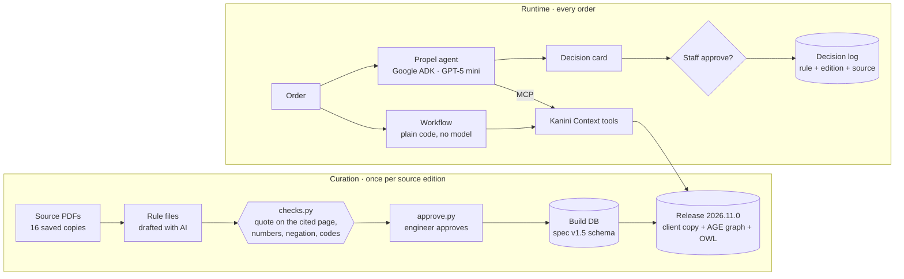

<div align="center">

# Kanini Context

**Read the rules once. Answer every order from them.**

A context layer for prior authorization: reviewed payer and Medicare rules, served to AI agents and workflows through MCP tools, with the source page behind every answer.


Prepared by NANDHU S K

</div>

---

## Latest results · 13 Nov 2026

Six synthetic orders, five runs each, GPT-5 mini at reasoning effort low. Reports: `propel/baseline/results/compare-20261113-0850.md` (A and A'), `compare-20261112-2256.md` (B).

> **How to read this table.** C is the answer key: the engineer-approved rules applied by plain code, with no AI. Every lane is checked against it, so C cannot score anything but full marks, and its column shows cost and repeatability, not accuracy. Whether the key itself is right rests on the rules: each one quotes its source page and was checked by the engineer, and the six expected answers match the scope's scenarios (scenario 3 changed as `docs/SCOPE_FINDINGS.md` explains). A and A' are a plain LLM application with no Kanini Context, answering from the same 16-document policy library, and are graded against the key. B takes its answer from the rules by design, so its check is that the agent asked the rules the right question.

| | **A** · AI + RAG over the library | **A'** · AI reads the whole library | **B** · AI agent asks Kanini Context | **C** · no AI: the approved rules, applied directly |
| :-- | :--: | :--: | :--: | :--: |
| **What the AI is given** | the 16 passages that best match the order | all 16 documents, whole | the rules' answer for the order, through tools | no AI |
| **Against the answer key** | 11 of 30 match | 18 of 30 match | 30 of 30 used the rules' answer | *is the key* |
| **Model calls per order** | 1 (plus one embedding lookup) | 1 | 4 to 5 | **0** |
| **Input tokens per order** | 7,605 to 9,343 | 147,525 | 10,512 to 13,671 | **0** |
| **Time per order** | 4.6 to 6.7 s | 7.1 to 11 s | 7.1 to 16 s, once its tool connections are open | **0.03 s** |
| **Same answer every run** | no | no | yes | yes |

**In plain words**

- **Without Kanini Context, the AI gets it wrong often.** Searching the library (RAG), it matched the rules 11 times in 30; reading every document, 18 in 30, at about 148,000 tokens per order.
- **Retrieval picks the wrong region.** For the Ohio order, RAG brought back twelve passages of the Tennessee billing article and only one page each of Ohio's LCD (not its coverage criteria page) and Ohio's article. The AI answered "other gate" in 5 runs of 5: the Tennessee answer for eGFR 52, where Ohio allows < 60. Kanini Context binds each rule to its contractor region, so the question never reaches the wrong policy.
- **Silence is read as a rule.** On the anemia drug under UnitedHealthcare, where the list names it only with a cancer diagnosis, both A and A' said "PA required" (one run of A' said "No PA"); none routed it to staff, the answer the documents support.
- **C is the point.** Once the rules are read, checked and approved, deciding an order needs no model at all: 30 milliseconds, the same answer every time. C is not "more accurate" than A; it is the reviewed answer, delivered with no model call.
- **B is the assistant.** When staff want an explanation, the agent uses 4 to 5 short model calls, about 12,000 tokens, and can only state what the rules returned. Its own decision card agreed with the rules every time it wrote one before approval (8 of 8); when it sends the record request alone, the card is written from the rules, so staff always see it before approving.
- **Even the right pages are not enough.** In an earlier run A was handed exactly the pages Kanini Context picked for each order and still matched only 21 of 30 at low reasoning effort, 23 of 30 at medium (`compare-20261112-2210.md`, `compare-20261112-2238.md`).
- **Not counted in any lane:** the one-off model use when the rules were drafted from the documents, and embedding the library once for RAG.

### Scenario by scenario

| Order | Answer key (rules say) | A, RAG | A', whole library | B | C |
| :-- | :-- | :--: | :--: | :--: | :--: |
| `maria-tn` · Original Medicare, TN, eGFR 38 | **No PA** | ⚠️ 3/5 | ✅ 5/5 | ✅ 5/5 used it | key |
| `maria-tn-egfr52` · same, eGFR 52 | **Other gate** (TN needs eGFR < 45) | ✅ 5/5 | ✅ 5/5 | ✅ 5/5 used it | key |
| `maria-oh` · Ohio, eGFR 52 | **No PA** (OH allows < 60) | ❌ 0/5 | ⚠️ 2/5 | ✅ 5/5 used it | key |
| `maria-uhc` · UHC Medicare Advantage, IV iron J1439 | **PA required**, 72 h / 24 h clock | ❌ 1/5 | ⚠️ 3/5 | ✅ 5/5 used it | key |
| `maria-uhc-esa` · UHC, anemia drug, no cancer diagnosis | **Not known**, route to staff | ❌ 0/5 | ❌ 0/5 | ✅ 5/5 used it | key |
| `maria-nohgb` · TN, hemoglobin missing | **Not yet known**, get the hemoglobin | ❌ 2/5 | ⚠️ 3/5 | ✅ 5/5 used it | key |

### Tests

| Suite | Result |
| :-- | :-- |
| Prototype scope, tests 1 to 23 (`tests/test_scope.py`) | ✅ all pass, plus the variants 5a to 5d, 10b and 22b |
| Scope tests 9 and 21 to 23 with the real model (`tests/test_agent_live.py`) | ✅ pass with GPT-5 mini |
| Pack tests: checks, approval, freshness, decision log, card guard (`tests/test_pack.py`) | ✅ pass |
| Dashboard: release graph and schema, live runs of A, B and C (`tests/test_dashboard.py`) | ✅ pass |
| Schema specification v1.5, 61 regression tests (`kanini_context/db/spec_regression/`) | ✅ same verdicts as the specification |

### Scope tests, one by one

The 23 tests of the prototype scope (12 Nov 2026, section 6), in `tests/test_scope.py` under the same numbers. They are strict: on a release with an unscreened CMS program or a source past its freshness limit, they fail and name it. Last run: 69 of 69 passed, 13 Nov 2026.

| # | Scope test | The scope expects | Result | Difference from the scope's example |
| --: | :-- | :-- | :--: | :-- |
| 1 | Rules loaded | the scope's rules listed with source and date | ✅ pass | 19 rules: the three in the scope (checked by id, source and date) plus the billing articles, UnitedHealthcare rules and CMS program screens |
| 2 | Region, Tennessee | L39237 resolved for Original Medicare in TN | ✅ pass | Citation reads "LCD L39237, Coverage Criteria B" |
| 3 | Region, Ohio | L34356 resolved for Original Medicare in OH | ✅ pass | none |
| 4 | Date | unavailable: no edition loaded for a date before the LCD | ✅ pass | Next step is the code `human_review` (route to staff) |
| 5 | Evaluate (four calls) | No PA, Other gate, No PA (Ohio), Not yet known | ✅ pass | Called with the order (plan, state, code, date, facts) rather than a rule id; 5d asks for Hb or HCT, as L39237 accepts either |
| 6 | Medicare Advantage plan | PA required, evidence from the UHC policy, 72 h / 24 h clock | ✅ pass | Run with IV iron J1439: UnitedHealthcare lists the ESA only with a cancer diagnosis (`docs/SCOPE_FINDINGS.md`) |
| 7 | Unknown payer | no rule found, not safe, route to staff | ✅ pass | none |
| 8 | Input guard | invalid input: unexpected field | ✅ pass | Nothing is written to the audit table |
| 9 | Agent end to end | trace journey.get → applicable rules → evaluate → policy search, then the card | ✅ pass | Same four tools; the rules lookup and the evaluation run in one model turn. Also run with GPT-5 mini |
| 10 | Decision log | approved entry with order, outcome, rule and reviewer | ✅ pass | Plus 10b: the logged decision replays with the same rule edition |
| 11 | Missing field | invalid input: missing field: plan | ✅ pass | none |
| 12 | Malformed date | invalid input: date_of_service must be a date | ✅ pass | none |
| 13 | Unknown service | no rule found, route to staff | ✅ pass | none |
| 14 | State outside the loaded regions | no rule found for CA | ✅ pass | Reason reads "no coverage policy loaded for CA", since the pack also holds non-LCD policies |
| 15 | Date beyond the pack | unavailable: pack not current for 2027 | ✅ pass | none |
| 16 | Boundary, eGFR | eGFR 45 is not < 45: Other gate | ✅ pass | none |
| 17 | Boundary, hemoglobin | Hb 10.0 is not < 10: Other gate | ✅ pass | With Hb 10.0 alone the answer asks for HCT (L39237 accepts either); with HCT 31 it is Other gate |
| 18 | Implausible value | invalid input: egfr out of range | ✅ pass | none |
| 19 | Stale lab | creatinine older than the LCD allows: Other gate | ✅ pass | Tennessee only: L34356 sets no time limit |
| 20 | Overlapping rule version | load rejected: overlapping active versions; graph unchanged | ✅ pass | none |
| 21 | Context Service unavailable | agent says it cannot reach Kanini Context and routes to staff | ✅ pass | Also run with GPT-5 mini |
| 22 | Instruction to skip checks | trace still shows the rules tools; answer from the tools | ✅ pass | With GPT-5 mini on `maria-uhc`, where the prompt's "no PA" contradicts the rules. Plus 22b: a card that contradicts the rules is corrected |
| 23 | Staff rejects the decision | rejected entry with the reviewer; nothing approved | ✅ pass | Also run with GPT-5 mini |

Every difference is explained in `docs/COVERAGE.md`, section 6.

---

## How it works



- **The outcome always comes from `rules_evaluate`:** SQL over reviewed rules, so the same question gets the same answer.
- **The model chooses the tools and writes the explanation, but it cannot change the outcome.** Before `journey_record` runs, its fields are replaced with what `rules_evaluate` returned, and the card's Outcome line is set from the same result.
- **Silence is never "no".** No rule found, a missing fact, an aging source or an unscreened program all route to staff, naming the reason.

---

## Dashboard

`python -m propel.dashboard.server` opens the demo in a browser (http://127.0.0.1:8090). It runs the same agent and tools as `adk web` and shows each step as it happens:

| | |
| :-- | :-- |
| **Knowledge graph** | Every node and edge of the release, zoomable. Nodes settle in shells by type; labels appear as you zoom. When an order is answered, the nodes it rests on light up and move to the centre, the screened PA programs pulse orange, and comets run along the real path from plan, code and state to the rule and its source page. Click any node for its page, quote, hash or links. |
| **Schema** | The same view of the ontology: 53 classes and 17 relations from `kanini-context.ttl`. |
| **Decision card** | Outcome, reasons, next step, deadline, route, evidence, the rule and its quote, with Approve and Reject. The approval goes to the decision log. |
| **The race** | All three run live on the chosen order, in turn ("Run A, B, C in turn", each lane on its own so its time is its own) or one at a time. A is a plain LLM application with no Kanini Context: it ranks the whole policy library against the order, sends the best 16 passages to the AI (hover the lane to see them) and marks its answer against the rules; B counts the agent's model calls; C times the lookup with no AI. Nothing is shown before a run except the last comparison, labelled as such. |

`--scripted` runs a scripted stand-in model, for a rehearsal with no API key; the page says so.

---

## The schema: specification v1.5 and what the prototype built

The database is the specification's schema. The release also writes it out as an OWL ontology (`kanini_context/release/kanini-context.ttl`) and an Apache AGE graph, all from the same registry.


<sub>Core of the model. The full ontology has 53 classes, including every program, authority and endpoint kind.</sub>

| | Specification v1.5 | Built in the prototype |
| :-- | :--: | :--: |
| Classes | 51 | **53**: adds `CoverageCriteria` (rule kind) and `PaProgram` (authority kind) |
| Relations | 17 | **17**: as specified |
| Attributes | 89 | **93**: adds `rule_key`, `review_exception`, `closed_list`, `covers_through` |
| Rule kinds | 5 | **6**: adds `coverage_criteria`, so medical-necessity criteria are tested, not just PA |
| Layers and effects (4.1) | ✓ | ✓ unchanged resolver logic |
| Dates: four bounds and record time (5.1) | ✓ | ✓ every tool takes an "as recorded" moment, so any answer can be replayed |
| "Not required" (4.6) | from a stated rule | also `stated_by_exhaustion`: only when every program bound to the plan, state and date is a screened closed list |
| Approval (6.5) | two approvers | one engineer with a recorded exception, as the prototype scope sets it |
| Tools (7.2) | 7 tools | the 7 tools, plus the scope's 3 (`context_applicable_rules`, `rules_evaluate`, `policy_search`), over MCP |
| Client copy and freshness (6.6) | signed read-only schema | second database `kc_client`; limits 14 and 45 days per source |
| Ontology file (6.1) | ✓ | ✓ generated at every build |
| Regression tests (8) | 61 | ✓ same verdicts |

Section by section, with the reasons: `docs/PROTOTYPE_NOTES.md`. Every scope item and test mapped to its evidence: `docs/COVERAGE.md`. Every schema and resolver change is listed at the top of `kanini_context/db/schema.sql` and `resolver.sql`.

---

## What's in the pack

| | |
| :-- | :-- |
| **Use case** | Anemia drug (ESA) for chronic kidney disease, not on dialysis; IV iron under UnitedHealthcare (scope findings, section 2) |
| **Coverage** | Original Medicare in Tennessee (LCD L39237, Article A58982) and Ohio (LCD L34356, Article A56462); UnitedHealthcare Medicare Advantage |
| **Sources** | 16 saved public documents, each with URL, edition, SHA-256 and dated checks (`kanini_context/sources/manifest.json`) |
| **Rules** | 19, each with its page, exact quote, conditions and tests, approved by one engineer |
| **CMS programs** | Every Original Medicare PA program bound to each state is screened against its own code list, including three found during the build (ASC demonstration, DMEPOS probationary, IRF expansion) |

---

## Run it

Needs Docker and Python 3.12 or 3.13.

```bash
docker compose up -d db                                     # PostgreSQL 16 + Apache AGE 1.6.0
python -m venv .venv && .venv\Scripts\activate              # macOS/Linux: source .venv/bin/activate
pip install -r requirements.txt
cp .env.example .env                                        # add OPENAI_API_KEY

python -m kanini_context.sources.place ~/Downloads          # put the saved source copies in place (matched by hash)
python -m kanini_context.curation.checks                    # every quote on its cited page
python -m kanini_context.curation.approve --by "NANDHU S K" # engineer approval, once per edition
python -m kanini_context.release.build                      # release 2026.11.0
pytest                                                      # 69 tests; strict: fails if a CMS program is unscreened or a source is past its limit

python -m kanini_context.server.mcp_server --http 8765      # terminal 1: Kanini Context tools
python -m propel.dashboard.server                      # terminal 2: the dashboard, http://127.0.0.1:8090
adk web propel/agent                                        # or the plain ADK web UI, http://127.0.0.1:8000
python -m propel.baseline.compare --runs 5                  # the A / A' / B / C comparison (B needs the server running)
python -m propel.baseline.compare --runs 5 --only A         # A (RAG) and A' (whole library) only; no server needed
```

<details>
<summary><b>Day-to-day commands</b></summary>

| Command | What it does |
| :-- | :-- |
| `python -m kanini_context.sources.place --checked SOURCE_ID "note"` | Records today's recheck of a source on its URL (answers are held after 14 days) |
| `python -m kanini_context.sources.place --record FOLDER` | Records a newly saved source copy (hash, size, date) |
| `python -m kanini_context.release.sync` | Records a client sync on the demo day |
| `python -m propel.baseline.compare --offline` | Mode C and A's prompt sizes, with no model calls |
| `python -m propel.baseline.compare --a-docs rag` | A by RAG only (`whole` for the whole library only) |

</details>

<details>
<summary><b>Repository layout</b></summary>

| Path | What it holds |
| :-- | :-- |
| `kanini_context/sources/` | Source manifest, `place.py`, `raw/` for the PDFs (not in git) |
| `kanini_context/rules/` | One rule file per source |
| `kanini_context/curation/` | `checks.py`, `approve.py`, `load.py`, `pdftext.py` |
| `kanini_context/db/` | `schema.sql`, `registry.sql`, `resolver.sql`, `api.sql`, `spec_regression/` |
| `kanini_context/release/` | `build.py`, `sync.py`, `owl.py`, `kanini-context.ttl` |
| `kanini_context/server/` | The Kanini Context MCP server |
| `propel/journey/` | Synthetic patients and orders, journey MCP server, decision log |
| `propel/agent/authorization_agent/` | The ADK agent |
| `propel/baseline/` | The A / B / C comparison |
| `propel/dashboard/` | The browser dashboard: FastAPI server, page, vendored d3 and fonts |
| `tests/` | Scope tests 1 to 23, pack tests, live-model tests, scripted model |
| `docs/` | Scope findings, prototype notes, demo script |

</details>

<details>
<summary><b>Two answers that differ from the scope's examples, on purpose</b></summary>

LCD L39237 accepts "Hb < 10 g/dL **or** HCT < 30%", so either result settles it:

- **Test 5, no hemoglobin:** the answer asks for hemoglobin or hematocrit.
- **Test 17, Hb exactly 10.0:** with a hematocrit of 30% or more the answer is "other gate"; with no hematocrit it is "not yet known".

</details>

---

<div align="center">
<sub>Synthetic data only. No patient information is stored or sent to Kanini Context.</sub>
</div>
