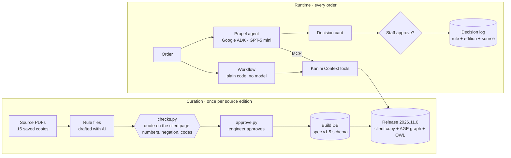
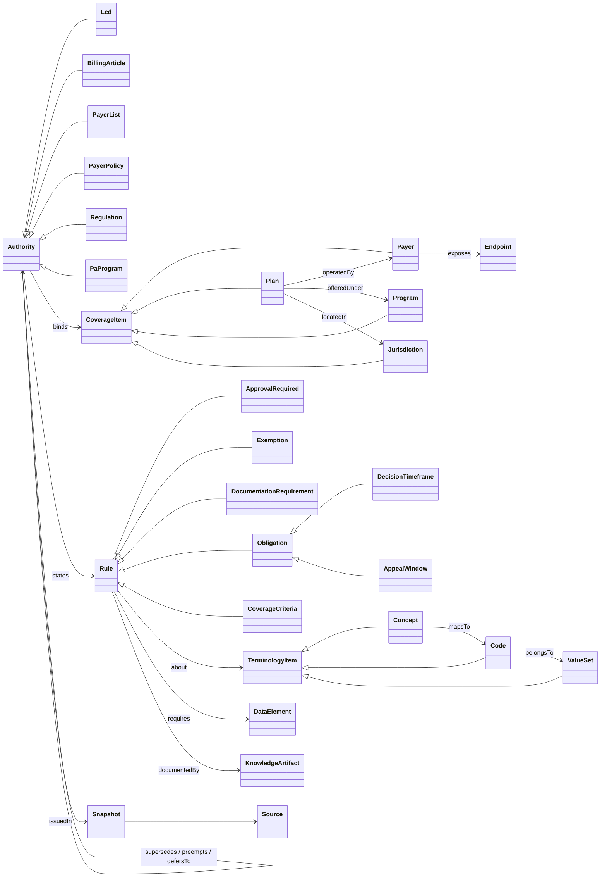

<div align="center">

# Kanini Context

**Read the rules once. Answer every order from them.**

A context layer for prior authorization: reviewed payer and Medicare rules, served to AI agents and workflows through MCP tools, with the source page behind every answer.


Prepared by NANDHU S K

</div>

---

## Latest results · 12 Nov 2026

Six synthetic orders, five runs each, GPT-5 mini (reasoning effort low). Full report: `propel/baseline/results/compare-20261112-1854.md`.

| | **A** · the model reads the policies | **B** · agent with Kanini Context | **C** · workflow with Kanini Context |
| :-- | :--: | :--: | :--: |
| **Right answer** | 20 of 30 | **30 of 30** | **30 of 30** |
| **Model calls per order** | 1 | 4 to 4.8 | **0** |
| **Input tokens per order** | 22,455 to 39,313 | 10,512 to 13,124 | **0** |
| **Time per order** | 5.5 to 11 s | 10 to 13 s | **0.03 s** |
| **Same answer every run** | no | yes | yes |

**In plain words**

- **C is the point.** Once the rules are read, checked and approved, deciding an order needs no model at all: 30 milliseconds, the same answer every time.
- **B is the assistant.** When staff want an explanation, the agent uses a third to a half of A's tokens and can only ever state what the rules returned.
- **A guesses where the documents are silent.**
  - For an anemia drug under UnitedHealthcare with a kidney (not cancer) diagnosis, the list is silent, so the right answer is "route to staff". A said "PA required" in all 5 runs.
  - With the hemoglobin result missing, A said "No PA" 3 times and "Other gate" 2 times, on the same input. Kanini Context says "get the hemoglobin" every time.
- A was given only the pages Kanini Context selected. Read whole, the same documents are 39,193 to 74,580 tokens per order.

### Scenario by scenario

| Order | Rules say | A | B | C |
| :-- | :-- | :--: | :--: | :--: |
| `maria-tn` · Original Medicare, TN, eGFR 38 | **No PA** | ✅ 5/5 | ✅ 5/5 | ✅ 5/5 |
| `maria-tn-egfr52` · same, eGFR 52 | **Other gate** (TN needs eGFR < 45) | ✅ 5/5 | ✅ 5/5 | ✅ 5/5 |
| `maria-oh` · Ohio, eGFR 52 | **No PA** (OH allows < 60) | ✅ 5/5 | ✅ 5/5 | ✅ 5/5 |
| `maria-uhc` · UHC Medicare Advantage, IV iron J1439 | **PA required**, 72 h / 24 h clock | ✅ 5/5 | ✅ 5/5 | ✅ 5/5 |
| `maria-uhc-esa` · UHC, anemia drug, no cancer diagnosis | **Not known**, route to staff | ❌ 0/5 | ✅ 5/5 | ✅ 5/5 |
| `maria-nohgb` · TN, hemoglobin missing | **Not yet known**, get the hemoglobin | ❌ 0/5 | ✅ 5/5 | ✅ 5/5 |

### Tests

| Suite | Result |
| :-- | :-- |
| Prototype scope, tests 1 to 23 (`tests/test_scope.py`) | ✅ all pass, plus the variants 5a to 5d, 10b and 22b |
| Scope tests 9 and 21 to 23 with the real model (`tests/test_agent_live.py`) | ✅ pass with GPT-5 mini |
| Pack tests: checks, approval, freshness, decision log, card guard (`tests/test_pack.py`) | ✅ pass |
| Schema specification v1.5, 61 regression tests (`kanini_context/db/spec_regression/`) | ✅ same verdicts as the specification |

---

## How it works



- **The outcome always comes from `rules_evaluate`:** SQL over reviewed rules, so the same question gets the same answer.
- **The model chooses the tools and writes the explanation, but it cannot change the outcome.** Before `journey_record` runs, its fields are replaced with what `rules_evaluate` returned, and the card's Outcome line is set from the same result.
- **Silence is never "no".** No rule found, a missing fact, an aging source or an unscreened program all route to staff, naming the reason.

---

## The schema: specification v1.5 and what the prototype built

The database is the specification's schema. The release also writes it out as an OWL ontology (`kanini_context/release/kanini-context.ttl`) and an Apache AGE graph, all from the same registry.



<sub>Core of the model. The full ontology has 53 classes, including every program, authority and endpoint kind.</sub>

| | Specification v1.5 | Built in the prototype |
| :-- | :--: | :--: |
| Classes | 51 | **53**: adds `CoverageCriteria` (rule kind) and `PaProgram` (authority kind) |
| Relations | 17 | **17**: as specified |
| Attributes | 89 | **93**: adds `rule_key`, `review_exception`, `closed_list`, `covers_through` |
| Rule kinds | 5 | **6**: adds `coverage_criteria`, so medical-necessity criteria are tested, not just PA |
| Layers and effects (4.1) | ✓ | ✓ unchanged resolver logic |
| Dates: four bounds and record time (5.1) | ✓ | ✓ every tool takes an "as recorded" moment, so any answer can be replayed |
| "Not required" (4.6) | from a stated rule | also `stated_by_exhaustion`: only when every program bound to the plan, state and date is a screened closed list |
| Approval (6.5) | two approvers | one engineer with a recorded exception, as the prototype scope sets it |
| Tools (7.2) | 7 tools | the 7 tools, plus the scope's 3 (`context_applicable_rules`, `rules_evaluate`, `policy_search`), over MCP |
| Client copy and freshness (6.6) | signed read-only schema | second database `kc_client`; limits 14 and 45 days per source |
| Ontology file (6.1) | ✓ | ✓ generated at every build |
| Regression tests (8) | 61 | ✓ same verdicts |

Section by section, with the reasons: `docs/PROTOTYPE_NOTES.md`. Every schema and resolver change is listed at the top of `kanini_context/db/schema.sql` and `resolver.sql`.

---

## What's in the pack

| | |
| :-- | :-- |
| **Use case** | Anemia drug (ESA) for chronic kidney disease, not on dialysis; IV iron under UnitedHealthcare (scope findings, section 2) |
| **Coverage** | Original Medicare in Tennessee (LCD L39237, Article A58982) and Ohio (LCD L34356, Article A56462); UnitedHealthcare Medicare Advantage |
| **Sources** | 16 saved public documents, each with URL, edition, SHA-256 and dated checks (`kanini_context/sources/manifest.json`) |
| **Rules** | 19, each with its page, exact quote, conditions and tests, approved by one engineer |
| **CMS programs** | Every Original Medicare PA program bound to each state is screened against its own code list, including three found during the build (ASC demonstration, DMEPOS probationary, IRF expansion) |

---

## Run it

Needs Docker and Python 3.12 or 3.13.

```bash
docker compose up -d db                                     # PostgreSQL 16 + Apache AGE 1.6.0
python -m venv .venv && .venv\Scripts\activate              # macOS/Linux: source .venv/bin/activate
pip install -r requirements.txt
cp .env.example .env                                        # add OPENAI_API_KEY

python -m kanini_context.sources.place ~/Downloads          # put the saved source copies in place (matched by hash)
python -m kanini_context.curation.checks                    # every quote on its cited page
python -m kanini_context.curation.approve --by "NANDHU S K" # engineer approval, once per edition
python -m kanini_context.release.build                      # release 2026.11.0
pytest                                                      # 60 tests

python -m kanini_context.server.mcp_server --http 8765      # terminal 1: Kanini Context tools
adk web propel/agent                                        # terminal 2: http://127.0.0.1:8000
python -m propel.baseline.compare --runs 5                  # the A / B / C comparison
```

<details>
<summary><b>Day-to-day commands</b></summary>

| Command | What it does |
| :-- | :-- |
| `python -m kanini_context.sources.place --checked SOURCE_ID "note"` | Records today's recheck of a source on its URL (answers are held after 14 days) |
| `python -m kanini_context.sources.place --record FOLDER` | Records a newly saved source copy (hash, size, date) |
| `python -m kanini_context.release.sync` | Records a client sync on the demo day |
| `python -m propel.baseline.compare --offline` | Mode C and A's prompt sizes, with no model calls |

</details>

<details>
<summary><b>Repository layout</b></summary>

| Path | What it holds |
| :-- | :-- |
| `kanini_context/sources/` | Source manifest, `place.py`, `raw/` for the PDFs (not in git) |
| `kanini_context/rules/` | One rule file per source |
| `kanini_context/curation/` | `checks.py`, `approve.py`, `load.py`, `pdftext.py` |
| `kanini_context/db/` | `schema.sql`, `registry.sql`, `resolver.sql`, `api.sql`, `spec_regression/` |
| `kanini_context/release/` | `build.py`, `sync.py`, `owl.py`, `kanini-context.ttl` |
| `kanini_context/server/` | The Kanini Context MCP server |
| `propel/journey/` | Synthetic patients and orders, journey MCP server, decision log |
| `propel/agent/authorization_agent/` | The ADK agent |
| `propel/baseline/` | The A / B / C comparison |
| `tests/` | Scope tests 1 to 23, pack tests, live-model tests, scripted model |
| `docs/` | Scope findings, prototype notes, demo script |

</details>

<details>
<summary><b>Two answers that differ from the scope's examples, on purpose</b></summary>

LCD L39237 accepts "Hb < 10 g/dL **or** HCT < 30%", so either result settles it:

- **Test 5, no hemoglobin:** the answer asks for hemoglobin or hematocrit.
- **Test 17, Hb exactly 10.0:** with a hematocrit of 30% or more the answer is "other gate"; with no hematocrit it is "not yet known".

</details>

---

<div align="center">
<sub>Synthetic data only. No patient information is stored or sent to Kanini Context.</sub>
</div>
