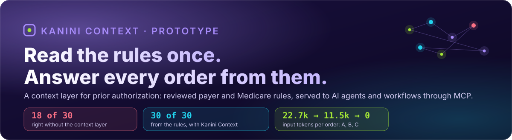
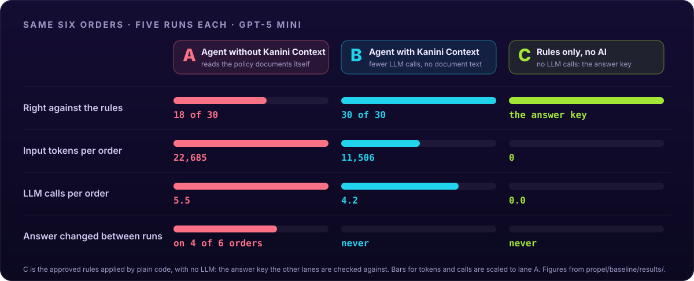
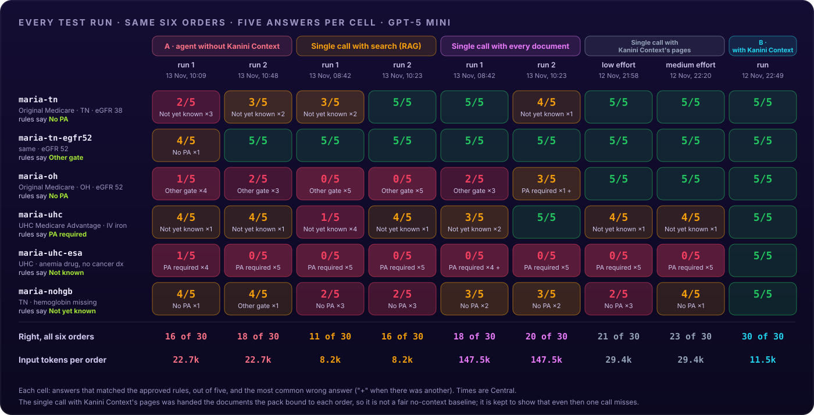
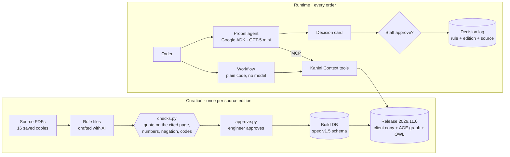
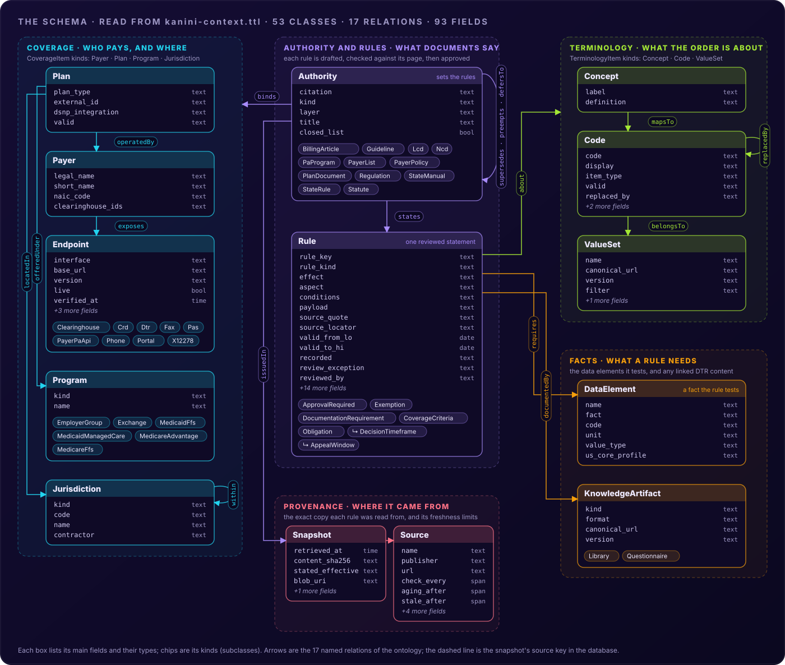

<div align="center">



<br>


[Results](#results) · [Every test run](#every-test-run) · [What each run got wrong](#what-each-run-got-wrong) · [How it works](#how-it-works) · [Dashboard](#dashboard) · [Tests](#tests-and-scope-coverage) · [Schema](#schema) · [Running it](#running-it)

<sub>Prepared by NANDHU S K</sub>

</div>

> [!IMPORTANT]
> The prototype has to show what the Kanini Context layer is worth, and how it reduces or removes repeated LLM calls for information the context already holds. So the comparison runs the same agent with and without it.

<br>

## Results



<sub>Drawn from the reports in <code>propel/baseline/results/</code>: <code>compare-20261113-1056</code> (A; first run <code>compare-20261113-1017</code>), <code>compare-20261112-2256</code> (B and C), <code>compare-20261113-0850</code> and <code>compare-20261113-1031</code> (one-call baselines). Every run, order by order, is under <a href="#every-test-run">Every test run</a>.</sub>

| | **A** · same agent, no context | **B** · agent with Kanini Context (reduce) | **C** · Kanini Context, no AI (eliminate) |
| :-- | :--: | :--: | :--: |
| **Against the answer key** | 18 of 30 match (first run 16 of 30; 34 of 60 over both) | 30 of 30 used the rules' answer | *is the key* |
| **Model calls per order** | 5.2 to 6.0 | 4 to 5 | **0** |
| **Input tokens per order** | 18,387 to 27,025 (average 22,700) | 10,512 to 13,671 | **0** |
| **Document text read per order** | 1.2 to 2.0 searches, 2.0 to 3.2 pages | none | none |
| **Time per order** | 12.8 to 14.7 s | 7.1 to 16 s | **0.03 s** |
| **Same answer every run** | no: changed between runs on 4 of 6 orders (6 of 6 in the first run) | yes | yes |

> [!NOTE]
> A is the Propel agent with no Kanini Context. It has the same model and the same patient-record tool, plus three document tools (list, search, read pages) in place of the context layer, so it finds and reads the policy itself for every order. B is the same agent with Kanini Context. C is Kanini Context with no AI: the engineer-approved rules applied by plain code. C is the answer key, so it always scores full marks, and its column is there to show cost and repeatability.

<details>
<summary><b>How each lane is graded, and what the answer key rests on</b></summary>

<br>

The answer key comes from the rules. Each rule quotes its source page and was checked by the engineer, and the six expected answers match the scope's scenarios (scenario 3 changed, for the reason given in `docs/SCOPE_FINDINGS.md`).

B takes its answer from the rules by design, so B's check is whether the agent asked the rules the right question. If it asks to record a decision without writing a card, the card is filled in from the rules' answer.

A is graded on the Outcome line of the card it writes itself, and on the outcome alone. Nobody told A what the rules mean by "safe to act" (safe to proceed on this answer, which includes submitting a required PA), and it marks most "PA required" cards "not safe to act". Counting that flag as well, A's second run would match 13 of 30 instead of 18.

A's document tools are a plain library: the documents' own titles, a search over every document with no filter by state, and page reads. Working out which contractor's policy governs an order is part of the job the context layer does.

</details>

### What changes with the context layer

<table>
<tr>
<td width="50%" valign="top">

**🔴 Without the context layer**

A searches and reads the policy again for every order. It used about twice B's tokens, matched the rules 18 times in 30 (16 in its first run), and gave more than one answer to the same question on 4 of the six orders.

- On the Ohio order it read Tennessee's policy. It answered "Other gate" in 3 of 5 runs (4 of 5 in the first), each time relying on Tennessee's billing article A58982: either its eGFR limit of 45 (Ohio's is 60) or its list of CKD codes, which leaves out the stage 3a code N18.31 that Ohio's article includes. Kanini Context binds each rule to its contractor region, so an Ohio order only ever meets Ohio's rules.
- On the anemia drug under UnitedHealthcare it treated the plan's silence as a rule. It said "PA required" in 5 of 5 runs (4 of 5 in the first), writing that the plan's list "explicitly lists Erythropoiesis Stimulating Agents (J0885) as requiring prior authorization". The list names J0885 only under cancer supportive care, for a cancer diagnosis (page 7), and this patient has none. The documents do not settle the order, so it should go to staff.
- On the Tennessee order that needs no PA, it answered "Not yet known" in 2 of 5 runs (3 of 5 in the first) and asked for iron studies that the approved coverage rule does not test.

</td>
<td width="50%" valign="top">

**🟢 With Kanini Context**

With Kanini Context (B), the same agent makes 4 to 5 short calls, reads no document text, and can only state what the rules returned, with the source, edition and safe-to-act flag. If it sends the record request without a card, the card is written from the rules, so staff always see one before approving.

Once the rules have been read, checked and approved, deciding an order needs no model at all (C). It takes 30 milliseconds and gives the same answer every time.

Neither lane counts the one-off model use when the rules were first drafted from the documents.

</td>
</tr>
</table>

### Scenario by scenario

| Order | Answer key (rules say) | A · no context (run 2) | B | C | Search (RAG), run 1 · 2 | Every document, run 1 · 2 |
| :-- | :-- | :--: | :--: | :--: | :--: | :--: |
| `maria-tn` · Original Medicare, TN, eGFR 38 | **No PA** | ⚠️ 3/5 | ✅ 5/5 | key | ⚠️ 3/5 · ✅ 5/5 | ✅ 5/5 · ⚠️ 4/5 |
| `maria-tn-egfr52` · same, eGFR 52 | **Other gate** (TN needs eGFR < 45) | ✅ 5/5 | ✅ 5/5 | key | ✅ 5/5 · ✅ 5/5 | ✅ 5/5 · ✅ 5/5 |
| `maria-oh` · Ohio, eGFR 52 | **No PA** (OH allows < 60) | ❌ 2/5 | ✅ 5/5 | key | ❌ 0/5 · ❌ 0/5 | ❌ 2/5 · ⚠️ 3/5 |
| `maria-uhc` · UHC Medicare Advantage, IV iron J1439 | **PA required**, 72 h / 24 h clock | ⚠️ 4/5 | ✅ 5/5 | key | ❌ 1/5 · ⚠️ 4/5 | ⚠️ 3/5 · ✅ 5/5 |
| `maria-uhc-esa` · UHC, anemia drug, no cancer diagnosis | **Not known**, route to staff | ❌ 0/5 | ✅ 5/5 | key | ❌ 0/5 · ❌ 0/5 | ❌ 0/5 · ❌ 0/5 |
| `maria-nohgb` · TN, hemoglobin missing | **Not yet known**, get the hemoglobin | ⚠️ 4/5 | ✅ 5/5 | key | ❌ 2/5 · ❌ 2/5 | ⚠️ 3/5 · ⚠️ 3/5 |

<br>

## Every test run

These are all the comparisons in `propel/baseline/results/`. Each covers the same six orders, with five answers per order per run. Besides lane A, two plain LLM applications answered in a single call from the same 16-document library. Search (RAG) was sent the 16 passages that best match the order; every document was sent the whole library. One more pair of runs gave a single call exactly the pages Kanini Context picked for each order.



| When (Central) | What was tested | What the AI was given | Right | Input tokens per order | Report |
| :-- | :-- | :-- | :--: | :--: | :-- |
| 12 Nov, 21:58 | One call, low effort | the pages Kanini Context picked for the order | 21 of 30 | 22,455 to 39,313 | `compare-20261112-2210` |
| 12 Nov, 22:20 | One call, medium effort | the same pages | 23 of 30 | 22,455 to 39,313 | `compare-20261112-2238` |
| 12 Nov, 22:49 | **B**: agent + Kanini Context | the rules' answer, no document text | **30 of 30** | 10,512 to 13,671 | `compare-20261112-2256` |
| 13 Nov, 08:42 | Search (RAG), run 1 | 16 passages ranked by embeddings | 11 of 30 | 7,605 to 9,343 | `compare-20261113-0850` |
| 13 Nov, 08:42 | Every document, run 1 | all 16 documents | 18 of 30 | about 147,500 | `compare-20261113-0850` |
| 13 Nov, 10:09 | **A**: same agent, no context, run 1 | search and page tools over the library | 16 of 30 | about 22,700 | `compare-20261113-1017` |
| 13 Nov, 10:23 | Search (RAG), run 2 | **the identical 16 passages** | 16 of 30 | 7,605 to 9,343 | `compare-20261113-1031` |
| 13 Nov, 10:23 | Every document, run 2 | **the identical library** | 20 of 30 | about 147,500 | `compare-20261113-1031` |
| 13 Nov, 10:48 | **A**: same agent, no context, run 2 | search and page tools over the library | 18 of 30 | 18,387 to 27,025 | `compare-20261113-1056` |

> [!WARNING]
> Search (RAG) was sent the identical 16 passages for every order in both of its runs, and every document was sent the identical library. The scores still moved, from 11 to 16 of 30 and from 18 to 20 of 30.

### Five kinds of mistake

Wrong answers out of five, per run (run 1 · run 2). Each row is one kind of mistake. The AI's own words for each are under [What each run got wrong](#what-each-run-got-wrong).

| Mistake | Order, and what the rules say | A · no context | Search (RAG) | Every document | Pages picked by Kanini Context | B |
| :-- | :-- | :--: | :--: | :--: | :--: | :--: |
| Read the wrong region's policy | `maria-oh`: No PA, Ohio allows eGFR < 60 | 4 · 3 | **5 · 5** | 3 · 1 | 0 · 0 | 0 |
| Read silence as a rule | `maria-uhc-esa`: Not known, route to staff | 4 · 5 | **5 · 5** | 4 · 5 | **5 · 5** | 0 |
| Missed a missing fact | `maria-nohgb`: Not yet known, get the hemoglobin | 1 · 1 | 3 · 3 | 2 · 2 | 3 · 1 | 0 |
| Invented a requirement | `maria-tn`: No PA | 3 · 2 | 2 · 0 | 0 · 1 | 0 · 0 | 0 |
| Asked for facts the plan's list does not need | `maria-uhc`: PA required | 1 · 1 | 4 · 1 | 2 · 0 | 1 · 1 | 0 |
| Other one-off answers | | 1 · 0 | 0 · 0 | 1 · 1 | 0 · 0 | 0 |
| **Wrong, all six orders** | | **14 · 12** | **19 · 14** | **12 · 10** | **9 · 7** | **0** |

<table>
<tr>
<td width="33%" valign="top">

**🟠 Search (RAG)**

It never retrieved the page that decides any of the four Original Medicare orders (LCD L39237 page 7 for Tennessee, L34356 page 8 for Ohio). It found the deciding page only for `maria-uhc` (the UHC list, page 17).

For the Ohio order, 12 of the 16 passages came from Tennessee's policy and 2 from Ohio's. It scored 0 of 5 in both runs, every answer "Other gate" under Tennessee's limit of 45. The Tennessee orders got 2 passages of Ohio's.

At about 8,200 tokens it was the cheapest way without the context layer, and the least accurate: 27 of 60.

</td>
<td width="33%" valign="top">

**🟣 Every document**

It costs about 147,500 tokens per order, about 13 times B, and scored 38 of 60.

Both the Ohio and the Tennessee policies were in the prompt, and it still applied Tennessee's limits to Ohio in 3 of 5 answers in its first run and 1 of 5 in its second. It read the cancer-only listing as a rule for the anemia drug in 9 of 10 answers.

</td>
<td width="33%" valign="top">

**⚪ Pages picked by Kanini Context**

This call was given exactly the documents the pack binds to each order, so the wrong-region mistake went away: 21, then 23 of 30.

The model still had to work the answer out from the text. It treated silence as a rule on all 10 answers for the anemia drug and missed the missing hemoglobin in 4 of 10.

The pack did the finding here, so this is not a fair no-context baseline and it is not lane A.

</td>
</tr>
</table>

<br>

## What each run got wrong

For each order: how each way without Kanini Context answered in its latest test, where each wrong answer departs from the approved rules, and the AI's own words with the source it cited.

<sub>Five answers per order from each way, GPT-5 mini at low reasoning effort. The same agent with no context ran on 13 Nov 2026 at 10:48 Central (`compare-20261113-1056.json`); search and every document ran at 10:23 (`compare-20261113-1031.json`). The dashboard's Testing tab shows the same text; <code>python -m propel.baseline.failures &lt;reports&gt; --collapsible</code> rebuilds it.</sub>

<details><summary><code>maria-tn</code> · rules say <b>No PA</b> · A ⚠️ 3/5 · search ✅ 5/5 · every doc ⚠️ 4/5</summary>

The rules' answer rests on LCD L39237, page 7.
- Same agent, no context: right 3 of 5. 2 runs answered Not yet known: every fact the rule tests is on the order.
  - In its own words (Not yet known, what it said was missing): “Staff should obtain and add to the chart the required pre-initiation iron studies (TSAT and ferritin) and documentation that other causes of anemia were evaluated/treated; confirm required claim modifiers (EC and JA/JB as appropriate) will be billed. Re-check…” Source it cited: Billing and Coding Article A58982 (for LCD L39237), pages 10–11 — required documentation elements for CKD not on dialysis (serum creatinine/GFR, diagnosis codes,…
- Search (RAG): right 5 of 5.
- Every document: right 4 of 5. 1 run answered Not yet known: every fact the rule tests is on the order.
  - In its own words (Not yet known, what it said was missing): “Missing required iron‑store data (transferrin saturation and ferritin) and documentation of iron repletion if low — required prior to ESA initiation/continuation”

</details>

<details><summary><code>maria-tn-egfr52</code> · rules say <b>Other gate</b> · A ✅ 5/5 · search ✅ 5/5 · every doc ✅ 5/5</summary>

The rules' answer rests on LCD L39237, page 7.
- Same agent, no context: right 5 of 5.
- Search (RAG): right 5 of 5.
- Every document: right 5 of 5.

</details>

<details><summary><code>maria-oh</code> · rules say <b>No PA</b> · A ❌ 2/5 · search ❌ 0/5 · every doc ⚠️ 3/5</summary>

The rules' answer rests on LCD L34356, page 8.
- Same agent, no context: right 2 of 5. 3 runs answered Other gate: the order meets the coverage criteria that govern it; Other gate is the answer under Tennessee's eGFR limit (below 45), not Ohio's (below 60) (2 of 3 runs used it); the stage 3a (N18.31) exclusion is in Tennessee's article A58982, while Ohio's article A56462 lists N18.31 (2 of 3 runs used it). 3 of them cited Tennessee's policy.
  - In its own words (Other gate): “Patient has CKD not on dialysis and diagnosis D63.1 (documented) but current eGFR 52 mL/min/1.73 m2 which is above the LCD’s reasonable GFR threshold (<45 mL/min/1.73 m2) to support ESA initiation for CKD-not-on-dialysis; hemoglobin 9.4 g/dL alone does not…” Source it cited: Billing & Coding Article A58982 (supports LCD L39237) — “For CKD NOT on Dialysis… a GFR < 45 mL/min/1.73m2 is a reasonable threshold to support ESA administration” and…
- Search (RAG): right 0 of 5. 5 runs answered Other gate: the order meets the coverage criteria that govern it; Other gate is the answer under Tennessee's eGFR limit (below 45), not Ohio's (below 60) (5 of 5 runs used it); the stage 3a (N18.31) exclusion is in Tennessee's article A58982, while Ohio's article A56462 lists N18.31 (5 of 5 runs used it).
  - In its own words (Other gate): “Patient has D63.1 (anemia in CKD) but CKD diagnosis is N18.31 (CKD stage 3a) which is not among the covered CKD stage codes required for non-dialysis ESA (N18.32, N18.4, N18.5, etc.); Guidance indicates a GFR <45 mL/min/1.73 m2 is a reasonable threshold to…”
  The deciding page was **not** among the 16 passages retrieved; 12 came from Tennessee's policy and 2 from Ohio's.
- Every document: right 3 of 5. 1 run answered PA required: no approval is needed for this order. 1 run answered Other gate: the order meets the coverage criteria that govern it; the stage 3a (N18.31) exclusion is in Tennessee's article A58982, while Ohio's article A56462 lists N18.31 (1 of 1 runs used it).
  - In its own words (PA required): “Patient has CKD not on dialysis with Hgb 9.4 (<10 g/dL) — meets the hemoglobin criterion for non‑ESRD ESA therapy under the CGS (Ohio) LCD; Patient’s eGFR 52 mL/min/1.73m2 meets the CGS LCD cutoff for CKD non‑dialysis coverage (GFR <60 mL/min/1.73m2) and…”
  - In its own words (Other gate): “HCPCS J0885 is for non-ESRD (CKD non-dialysis) ESA use under the CGS (Ohio) LCD (L34356).; Coverage for CKD non-dialysis requires anemia (Hgb <10) AND the required CKD stage documentation per CGS: L34356 requires GFR/Cr thresholds but the related…”

</details>

<details><summary><code>maria-uhc</code> · rules say <b>PA required</b> · A ⚠️ 4/5 · search ⚠️ 4/5 · every doc ✅ 5/5</summary>

The rules' answer rests on UHC MA prior authorization requirements, page 17.
- Same agent, no context: right 4 of 5. 1 run answered Not yet known: the plan's list requires PA for this code whatever the facts.
  - In its own words (Not yet known, what it said was missing): “Staff should submit a prior authorization request (or document medical necessity) that includes either: clinical documentation showing trials (dates, agents, doses, and response) of at least two preferred IV iron therapies (e.g., iron sucrose J1756, sodium…” Source it cited: UnitedHealthcare Medicare Advantage Drug Policy IAP.001.30, "Intravenous Iron Replacement Therapy" (pages 8, 17–18); UnitedHealthcare Medicare Advantage/Peoples Health…
- Search (RAG): right 4 of 5. 1 run answered Not yet known: the plan's list requires PA for this code whatever the facts.
  - In its own words (Not yet known, what it said was missing): “No documentation provided of prior trials, contraindications, or intolerance to preferred IV iron therapies for this member”
  The deciding page was among the 16 passages retrieved.
- Every document: right 5 of 5.

</details>

<details><summary><code>maria-uhc-esa</code> · rules say <b>Not known</b> · A ❌ 0/5 · search ❌ 0/5 · every doc ❌ 0/5</summary>

The documents do not settle it, so the order goes to staff.
- Same agent, no context: right 0 of 5. 5 runs answered PA required: the plan's list names this drug only under cancer supportive care, with PA "for a cancer diagnosis" (page 7), and this patient has none, so the documents do not settle this order.
  - In its own words (PA required): “UnitedHealthcare Medicare Advantage prior authorization list (Effective Oct 1, 2026) explicitly lists Erythropoiesis Stimulating Agents (J0885) as requiring prior authorization.” Source it cited: UnitedHealthcare Medicare Advantage/Peoples Health Plans prior authorization requirements, Effective October 1, 2026 — Erythropoiesis Stimulating Agents (J0885) (page…
- Search (RAG): right 0 of 5. 5 runs answered PA required: the plan's list names this drug only under cancer supportive care, with PA "for a cancer diagnosis" (page 7), and this patient has none, so the documents do not settle this order.
  - In its own words (PA required): “HCPCS J0885 is listed in UnitedHealthcare Medicare Advantage prior authorization requirements for erythropoiesis stimulating agents; Member has CKD non-dialysis diagnosis (D63.1 and N18.32) which aligns with indications in the ESA billing guidance, but UHC…”
- Every document: right 0 of 5. 5 runs answered PA required: the plan's list names this drug only under cancer supportive care, with PA "for a cancer diagnosis" (page 7), and this patient has none, so the documents do not settle this order.
  - In its own words (PA required): “UnitedHealthcare Medicare Advantage lists erythropoiesis stimulating agents (HCPCS J0885) as a drug requiring prior authorization (see UnitedHealthcare prior authorization requirements).; Medicare/local coverage criteria (LCD L39237 / Billing & Coding A58982)…”

</details>

<details><summary><code>maria-nohgb</code> · rules say <b>Not yet known</b> · A ⚠️ 4/5 · search ❌ 2/5 · every doc ⚠️ 3/5</summary>

The rules' answer rests on LCD L39237, page 7.
- Same agent, no context: right 4 of 5. 1 run answered Other gate: the order lacks a hematocrit or hemoglobin result, so it cannot be decided yet.
  - In its own words (Other gate): “Patient and order meet some CMS coverage prerequisites (J0885 for CKD non‑dialysis; diagnosis D63.1 and N18.32; eGFR 38 <45) — but required pre‑treatment iron studies and related documentation are not on file.” Source it cited: LCD L39237 (Palmetto, jurisdiction J covers Tennessee) — page 1; Billing & Coding Article A58982, “Erythropoiesis Stimulating Agents” — pages 10, 15, 17.
- Search (RAG): right 2 of 5. 3 runs answered No PA: the order lacks a hematocrit or hemoglobin result, so it cannot be decided yet.
  - In its own words (No PA): “Original Medicare Part B coverage policies (LCD L34356 / A58982) do not state a prior authorization requirement for non‑ESRD ESA (J0885).; Order is for non‑dialysis CKD anemia (HCPCS J0885) and the claim includes D63.1 and N18.32, which are the dual diagnoses…”
  The deciding page was **not** among the 16 passages retrieved; 2 came from Ohio's policy and 12 from Tennessee's.
- Every document: right 3 of 5. 2 runs answered No PA: the order lacks a hematocrit or hemoglobin result, so it cannot be decided yet.
  - In its own words (No PA): “This is Original Medicare Part B (not a Medicare Advantage plan) and none of the CMS prior-authorization/pre-claim review initiatives or demonstrations in the provided documents require prior authorization for ESA J0885.; Coverage and billing requirements for…”

</details>

<br>

## How it works



The outcome always comes from `rules_evaluate`, which is SQL over reviewed rules, so the same question gets the same answer. The model chooses the tools and writes the explanation. It cannot change the outcome: before `journey_record` runs, its fields are replaced with what `rules_evaluate` returned, and the card's Outcome line is set from the same result.

When the rules say nothing, the answer is never "no PA". No rule found, a missing fact, an aging source or an unscreened program each send the order to staff with the reason.

<br>

## Dashboard

`python -m propel.dashboard.server` opens the demo in a browser at http://127.0.0.1:8090. It runs the same agent and tools as `adk web` and shows each step as it happens.

| | |
| :-- | :-- |
| **Knowledge graph** | Every node and edge of the release, zoomable. Nodes settle in shells by type; labels appear as you zoom. When an order is answered, the nodes it rests on light up and move to the centre, the screened PA programs pulse orange, and dots travel the path from plan, code and state to the rule and its source page. Click any node for its page, quote, hash or links. |
| **Schema** | The ontology as a class diagram, read from `kanini-context.ttl` at every release: one box per class with its fields and its kinds (53 classes, 93 fields), the Terminology and Coverage groups as frames, and the 17 relations as named arrows. Click a class to see all its fields and zoom to its neighbours; after an answer, the classes it passed through glow. |
| **Decision card** | Outcome, reasons, next step, deadline, route, evidence, the rule and its quote, with Approve and Reject. The approval goes to the decision log. |
| **Without and with Kanini Context** | Three lanes run live on the chosen order, in turn or one at a time. **A** is the same agent and model with no Kanini Context: it searches and reads the policy documents itself for every order (each search and page shows as it happens) and its answer is marked against the rules. **B** is the agent with Kanini Context, making short calls with no document text. **C** is Kanini Context with no AI. The lanes are empty until a run; after it, each mark shows how often that way was right in testing. |
| **Testing** | The same six orders over repeated runs, from `propel/baseline/results/`: the agent without the context layer, and earlier baselines (an LLM application with search, or with every document), with how often each was right, how often its answer changed between runs, tokens and calls, and the reasons it went wrong. |

With `--scripted` it uses a scripted stand-in model and needs no API key. The page says when it is in that mode.

<br>

## Tests and scope coverage

| Suite | Result |
| :-- | :-- |
| Prototype scope, tests 1 to 23 (`tests/test_scope.py`) | ✅ all pass, plus the variants 5a to 5d, 10b and 22b |
| Scope tests 9 and 21 to 23 with the real model (`tests/test_agent_live.py`) | ✅ pass with GPT-5 mini |
| Pack tests: checks, approval, freshness, decision log, card guard (`tests/test_pack.py`) | ✅ pass |
| Dashboard: release graph and schema, live runs of A, B and C (`tests/test_dashboard.py`) | ✅ pass |
| Schema specification v1.5, 61 regression tests (`kanini_context/db/spec_regression/`) | ✅ same verdicts as the specification |

<details>
<summary><b>The 23 scope tests, one by one</b></summary>

<br>

The 23 tests of the prototype scope (12 Nov 2026, section 6), in `tests/test_scope.py` under the same numbers. They are strict: on a release with an unscreened CMS program or a source past its freshness limit, they fail and name it. The last full run, on the engineer's laptop on 13 Nov 2026, passed every test.

| # | Scope test | The scope expects | Result | Difference from the scope's example |
| --: | :-- | :-- | :--: | :-- |
| 1 | Rules loaded | the scope's rules listed with source and date | ✅ pass | 19 rules: the three in the scope (checked by id, source and date) plus the billing articles, UnitedHealthcare rules and CMS program screens |
| 2 | Region, Tennessee | L39237 resolved for Original Medicare in TN | ✅ pass | Citation reads "LCD L39237, Coverage Criteria B" |
| 3 | Region, Ohio | L34356 resolved for Original Medicare in OH | ✅ pass | none |
| 4 | Date | unavailable: no edition loaded for a date before the LCD | ✅ pass | Next step is the code `human_review` (route to staff) |
| 5 | Evaluate (four calls) | No PA, Other gate, No PA (Ohio), Not yet known | ✅ pass | Called with the order (plan, state, code, date, facts) rather than a rule id; 5d asks for Hb or HCT, as L39237 accepts either |
| 6 | Medicare Advantage plan | PA required, evidence from the UHC policy, 72 h / 24 h clock | ✅ pass | Run with IV iron J1439: UnitedHealthcare lists the ESA only with a cancer diagnosis (`docs/SCOPE_FINDINGS.md`) |
| 7 | Unknown payer | no rule found, not safe, route to staff | ✅ pass | none |
| 8 | Input guard | invalid input: unexpected field | ✅ pass | Nothing is written to the audit table |
| 9 | Agent end to end | trace journey.get → applicable rules → evaluate → policy search, then the card | ✅ pass | Same four tools; the rules lookup and the evaluation run in one model turn. Also run with GPT-5 mini |
| 10 | Decision log | approved entry with order, outcome, rule and reviewer | ✅ pass | Plus 10b: the logged decision replays with the same rule edition |
| 11 | Missing field | invalid input: missing field: plan | ✅ pass | none |
| 12 | Malformed date | invalid input: date_of_service must be a date | ✅ pass | none |
| 13 | Unknown service | no rule found, route to staff | ✅ pass | none |
| 14 | State outside the loaded regions | no rule found for CA | ✅ pass | Reason reads "no coverage policy loaded for CA", since the pack also holds non-LCD policies |
| 15 | Date beyond the pack | unavailable: pack not current for 2027 | ✅ pass | none |
| 16 | Boundary, eGFR | eGFR 45 is not < 45: Other gate | ✅ pass | none |
| 17 | Boundary, hemoglobin | Hb 10.0 is not < 10: Other gate | ✅ pass | With Hb 10.0 alone the answer asks for HCT (L39237 accepts either); with HCT 31 it is Other gate |
| 18 | Implausible value | invalid input: egfr out of range | ✅ pass | none |
| 19 | Stale lab | creatinine older than the LCD allows: Other gate | ✅ pass | Tennessee only: L34356 sets no time limit |
| 20 | Overlapping rule version | load rejected: overlapping active versions; graph unchanged | ✅ pass | none |
| 21 | Context Service unavailable | agent says it cannot reach Kanini Context and routes to staff | ✅ pass | Also run with GPT-5 mini |
| 22 | Instruction to skip checks | trace still shows the rules tools; answer from the tools | ✅ pass | With GPT-5 mini on `maria-uhc`, where the prompt's "no PA" contradicts the rules. Plus 22b: a card that contradicts the rules is corrected |
| 23 | Staff rejects the decision | rejected entry with the reviewer; nothing approved | ✅ pass | Also run with GPT-5 mini |

Every difference is explained in `docs/COVERAGE.md`, section 6.

</details>

<br>

## Schema

The database uses the specification's schema. Each release also writes it out as an OWL ontology (`kanini_context/release/kanini-context.ttl`) and an Apache AGE graph, both from the same registry.



<sub>Drawn from the release's ontology file (<code>kanini-context.ttl</code>). The dashboard's Schema tab has the same model with every field, and you can click through it.</sub>

An order's plan and state pick out a Plan and its Jurisdiction. From there the resolver finds the Authorities that bind them, and the Rules those authorities state about the order's Code (directly or through a ValueSet) that are in force on the date of service. Each rule's DataElements are checked against the order's facts, and the answer carries the rule's source quote and locator and the Snapshot it was read from.

| | Specification v1.5 | Built in the prototype |
| :-- | :--: | :--: |
| Classes | 51 | **53**: adds `CoverageCriteria` (rule kind) and `PaProgram` (authority kind) |
| Relations | 17 | **17**: as specified |
| Attributes | 89 | **93**: adds `rule_key`, `review_exception`, `closed_list`, `covers_through` |
| Rule kinds | 5 | **6**: adds `coverage_criteria`, so medical-necessity criteria are tested as well as PA |
| Layers and effects (4.1) | ✓ | ✓ unchanged resolver logic |
| Dates: four bounds and record time (5.1) | ✓ | ✓ every tool takes an "as recorded" moment, so any answer can be replayed |
| "Not required" (4.6) | from a stated rule | also `stated_by_exhaustion`: only when every program bound to the plan, state and date is a screened closed list |
| Approval (6.5) | two approvers | one engineer with a recorded exception, as the prototype scope sets it |
| Tools (7.2) | 7 tools | the 7 tools, plus the scope's 3 (`context_applicable_rules`, `rules_evaluate`, `policy_search`), over MCP |
| Client copy and freshness (6.6) | signed read-only schema | second database `kc_client`; limits 14 and 45 days per source |
| Ontology file (6.1) | ✓ | ✓ generated at every build |
| Regression tests (8) | 61 | ✓ same verdicts |

`docs/PROTOTYPE_NOTES.md` goes through the build section by section with the reasons, and `docs/COVERAGE.md` maps every scope item and test to its evidence. The schema and resolver changes are listed at the top of `kanini_context/db/schema.sql` and `resolver.sql`.

<br>

## What the pack holds

| | |
| :-- | :-- |
| **Use case** | Anemia drug (ESA) for chronic kidney disease, not on dialysis; IV iron under UnitedHealthcare (scope findings, section 2) |
| **Coverage** | Original Medicare in Tennessee (LCD L39237, Article A58982) and Ohio (LCD L34356, Article A56462); UnitedHealthcare Medicare Advantage |
| **Sources** | 16 saved public documents, each with URL, edition, SHA-256 and dated checks (`kanini_context/sources/manifest.json`) |
| **Rules** | 19, each with its page, exact quote, conditions and tests, approved by one engineer |
| **CMS programs** | Every Original Medicare PA program bound to each state is screened against its own code list, including three found during the build (ASC demonstration, DMEPOS probationary, IRF expansion) |

<br>

## Running it

Needs Docker and Python 3.12 or 3.13.

```bash
docker compose up -d db                                     # PostgreSQL 16 + Apache AGE 1.6.0
python -m venv .venv && .venv\Scripts\activate              # macOS/Linux: source .venv/bin/activate
pip install -r requirements.txt
cp .env.example .env                                        # add OPENAI_API_KEY

python -m kanini_context.sources.place ~/Downloads          # put the saved source copies in place (matched by hash)
python -m kanini_context.curation.checks                    # every quote on its cited page
python -m kanini_context.curation.approve --by "NANDHU S K" # engineer approval, once per edition
python -m kanini_context.release.build                      # release 2026.11.0
pytest                                                      # 75 tests; strict: fails if a CMS program is unscreened or a source is past its limit

python -m kanini_context.server.mcp_server --http 8765      # terminal 1: Kanini Context tools
python -m propel.dashboard.server                      # terminal 2: the dashboard, http://127.0.0.1:8090
adk web propel/agent                                        # or the plain ADK web UI, http://127.0.0.1:8000
python -m propel.baseline.compare --runs 5                  # the A / B / C comparison (B needs the server running)
python -m propel.baseline.compare --runs 5 --only A         # lane A only (the agent without Kanini Context); no server needed
python -m propel.baseline.compare --runs 5 --only A --a-docs rag,whole   # the one-call baselines: search and every document
```

<details>
<summary><b>Day-to-day commands</b></summary>

| Command | What it does |
| :-- | :-- |
| `python -m kanini_context.sources.place --checked SOURCE_ID "note"` | Records today's recheck of a source on its URL (answers are held after 14 days) |
| `python -m kanini_context.sources.place --record FOLDER` | Records a newly saved source copy (hash, size, date) |
| `python -m kanini_context.release.sync` | Records a client sync on the demo day |
| `python -m propel.baseline.compare --offline` | Mode C and A's prompt sizes, with no model calls |
| `python -m propel.baseline.compare --a-docs rag` | A by RAG only (`whole` for the whole library only) |

</details>

<details>
<summary><b>Repository layout</b></summary>

| Path | What it holds |
| :-- | :-- |
| `kanini_context/sources/` | Source manifest, `place.py`, `raw/` for the PDFs (not in git) |
| `kanini_context/rules/` | One rule file per source |
| `kanini_context/curation/` | `checks.py`, `approve.py`, `load.py`, `pdftext.py` |
| `kanini_context/db/` | `schema.sql`, `registry.sql`, `resolver.sql`, `api.sql`, `spec_regression/` |
| `kanini_context/release/` | `build.py`, `sync.py`, `owl.py`, `kanini-context.ttl` |
| `kanini_context/server/` | The Kanini Context MCP server |
| `propel/journey/` | Synthetic patients and orders, journey MCP server, decision log |
| `propel/agent/` | The ADK agents: `authorization_agent` (with Kanini Context, lane B) and `no_context_agent` (the same agent reading the documents itself, lane A) |
| `propel/baseline/` | The A / B / C comparison |
| `propel/dashboard/` | The browser dashboard: FastAPI server, page, vendored d3 and fonts |
| `tests/` | Scope tests 1 to 23, pack tests, live-model tests, scripted model |
| `docs/` | Scope findings, prototype notes, coverage map, README figures |

</details>

<details>
<summary><b>Two answers that differ from the scope's examples, on purpose</b></summary>

LCD L39237 accepts "Hb < 10 g/dL or HCT < 30%", so either result can settle the order. In test 5, with no hemoglobin, the answer asks for hemoglobin or hematocrit. In test 17, with Hb exactly 10.0, the answer is "other gate" if the hematocrit is 30% or more and "not yet known" if there is no hematocrit.

</details>

<br>

<div align="center">
<sub>Synthetic data only. No patient information is stored or sent to Kanini Context.</sub>
</div>
